# UI review v56 — phone

Reviewed in headless Chrome at 360×800 and 412×915, every tab, before and after the layout pass. Shots are in `docs/ui-v56/`. Full-page shots are taller than the viewport; the tab bar is `position: fixed`, so on a long capture it sits over the fold. On a phone it stays at the bottom while the page scrolls.

## What was messy

- Session actions used `width: 100%` plus a right margin, so controls sat tight against the edge and the stack felt uneven.
- The play hub stayed two columns until 360px, so 412px cards crushed their subtitles.
- The status bar put Session, Urgency, Saturation, and Next on one row. “Next” was a 92px clip.
- Seven tab labels had no room to wrap, so the bar was a row of tiny type.
- Bio-Logger sliders were short, and the tank line could run off the card.
- Profile and settings sections put a floated ⋮ on the summary, which collided with the title. Hidden pop menus sat in the line instead of over it.
- The alarm banner’s buttons were easy to miss next to a long sentence.
- Calendar quick actions were a 2×2 grid of short targets. The Urge “every N days” select used the browser’s default light control.
- The conditioning manager’s New / Retake / Export row and the sip-batch numbers needed to wrap instead of scroll sideways.

## What changed

- **I need to pee** is a full-width button on Session Control in every session type.
- Session buttons are a single column with 48px targets and no extra horizontal margin.
- Play hub is one column up to 520px.
- “Next” gets its own status row. Tab labels can wrap; the bar is a little taller.
- Sliders are 44px tall and full width. The tank readout wraps inside the card.
- Section headers are a flex row: grip, title, menu. Pin/Hide opens under the menu. Grips and menu buttons are at least 44px.
- Alarm banner text wraps; Reveal and Skip are full-width stacked buttons.
- Calendar quick actions stack. Selects use the dark field color. Stash counts stack to one column. Quiz and profile actions wrap to full-width rows.

## Before

Session, 360×800 (top) and the long page:

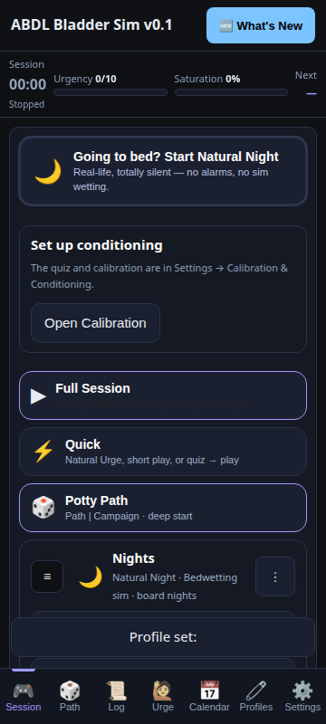

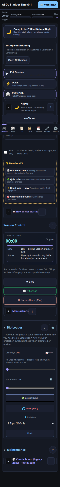

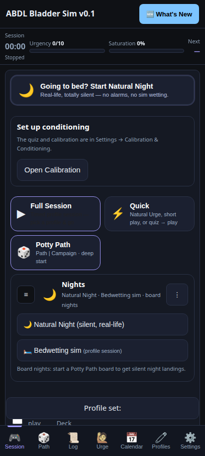

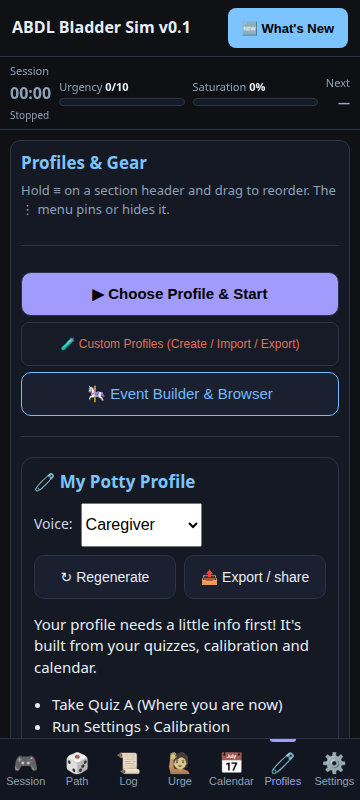

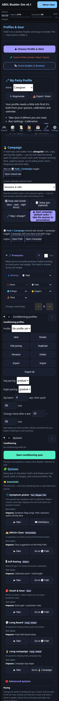

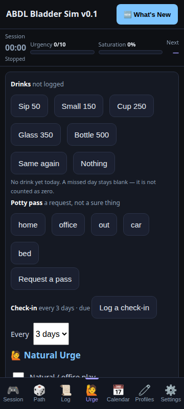

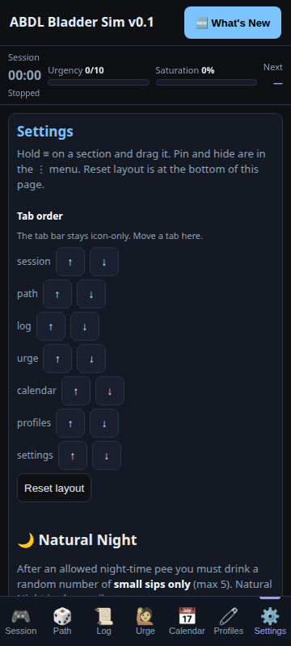

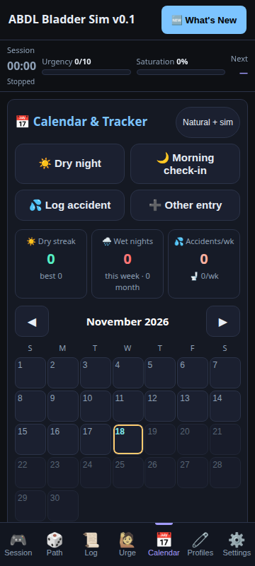

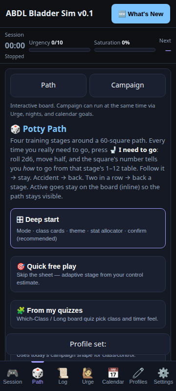

## After

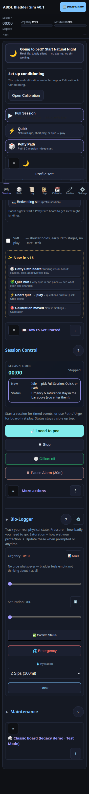

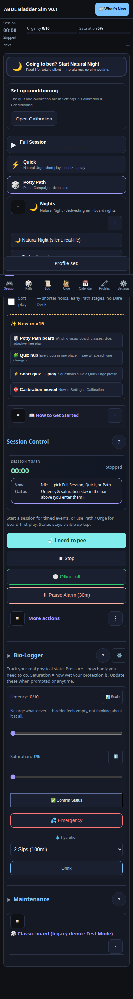

Bio-Logger and tank line at 360:

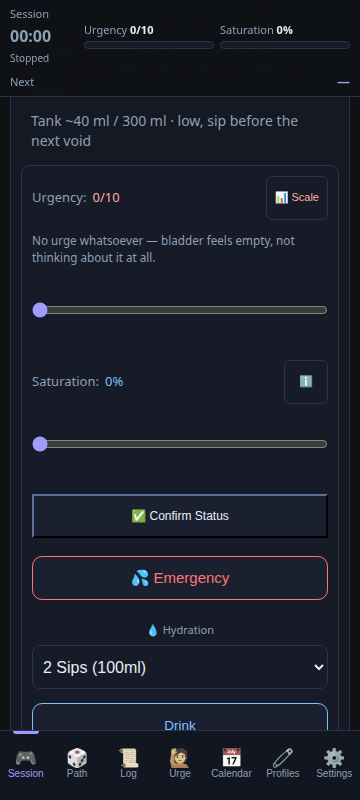

Alarm banner at 360 and 412:

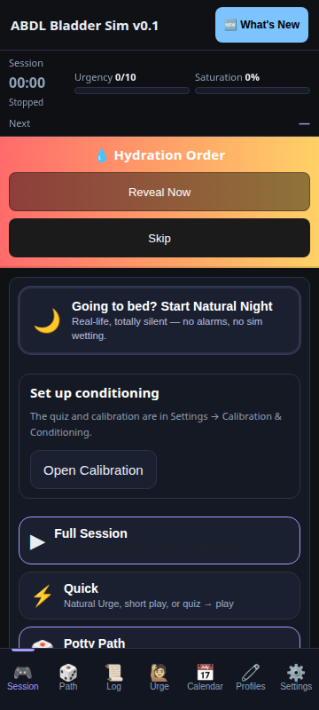

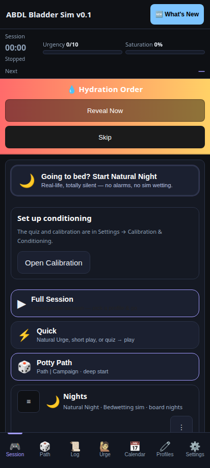

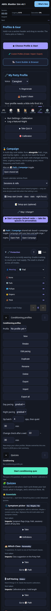

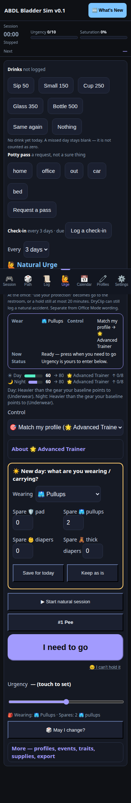

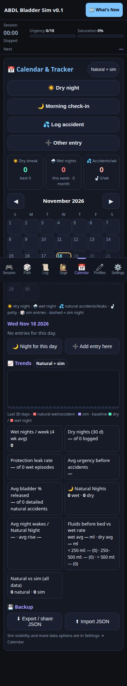

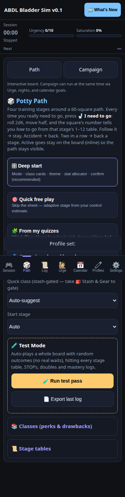

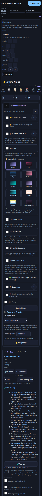

No horizontal page scroll at either width (`scrollWidth` matched the viewport on every tab).
